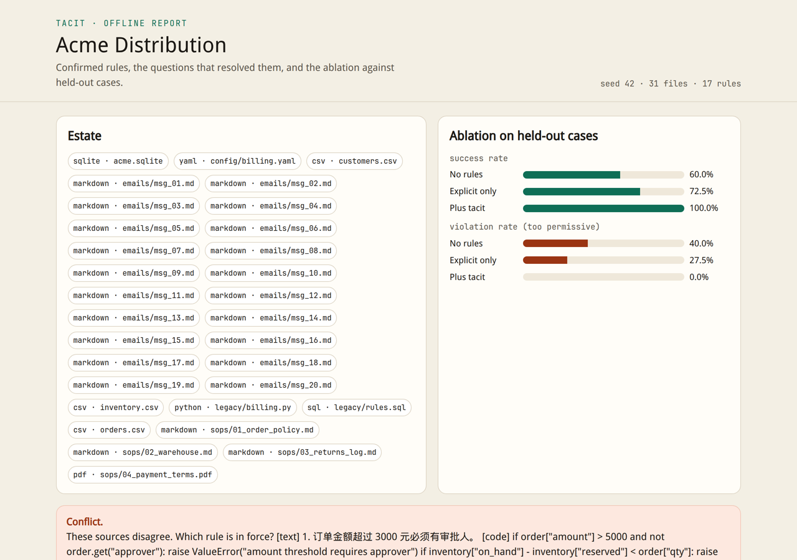
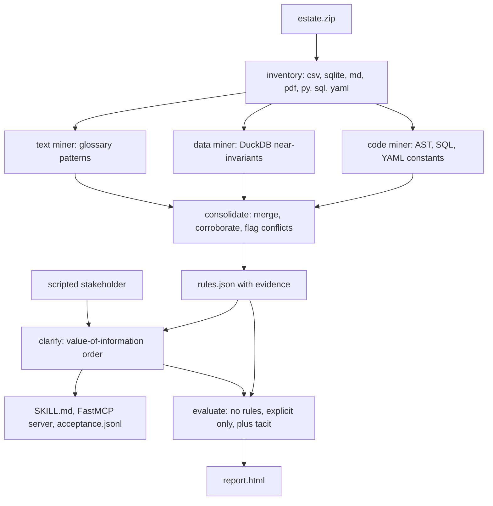
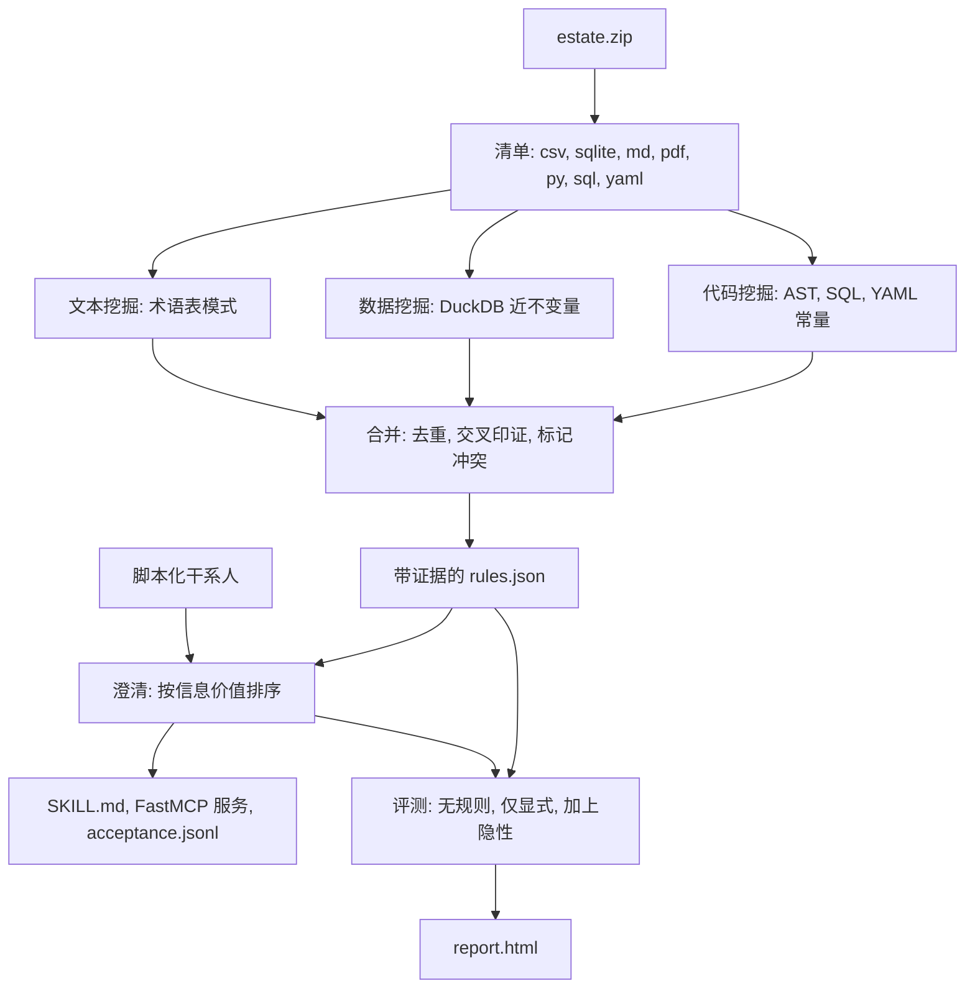

# Tacit

**Surface the rules nobody wrote down, then compile them into the agent.**

**把客户没写下来的规则挖出来，再编译进 agent。**

Tacit reads a messy customer bundle — spreadsheets, SQLite, SOPs, emails, legacy code, and config — and turns the rules buried in it into a provenance-tagged skill, a read-only [FastMCP](https://github.com/jlowin/fastmcp) server, and an acceptance set. The offline demo needs no API key.



[Scroll the same report](docs/demo.gif). That page is `tacit-demo/report.html` after `python -m tacit demo`.

The line under the demo — one zip, fifteen minutes, an agent that knows the business — is the story for a real estate, where a person still has to read the conflicts. The synthetic run is faster: ten estates (five seeds, two industries) finished in **59.06 seconds** on Python 3.12.3. See [Benchmark](#benchmark).

[中文说明](#中文)

## Why

Forward-deployed work stalls on constraints the customer never wrote down.

- [FDE-Gym](https://arxiv.org/abs/2610.22350) (arXiv:2610.22350) has 95 delivery tasks, 20 scenarios, 18 sectors. In the setting where unstated constraints must be discovered, the best of 13 model configurations scores **0.56** and resolves **14 of 95** tasks (score at least 0.8 and no incident). The abstract: “Discovering unstated constraints is the primary bottleneck.”
- [FDE-Bench](https://arxiv.org/abs/2610.14539) (arXiv:2610.14539) has 49 cases from real customer projects. Across 18 agent configurations the highest mean delivery score is **0.5510**, and the highest delivery success rate is **6.12%**.
- [From Code to Requirements](https://arxiv.org/abs/2609.22719) (Agrawal et al., Cognizant, arXiv:2609.22719) treats the same fact as an extraction problem: business logic lives in code, config, and institutional memory, and has to be reverse engineered.

The hiring wave around that job is recent, and the public write-ups disagree on the details, so the figures below are quoted from the pages that state them:

- On 30 June 2026, [CNBC](https://www.cnbc.com/2026/06/30/aws-amazon-ai-forward-deployed-engineers.html) reported that AWS is investing **$1 billion** in a Forward Deployed Engineering unit, seeded with thousands of FDEs, with “an initial pod of roughly five or six engineers” embedded at a customer.
- On 2 October 2026, [Anthropic](https://www.anthropic.com/news/claude-frontier-academy) announced the Claude Frontier Academy: a **$100 million** commitment to train **10,000** Frontier Deployed Engineers by the end of 2027. The residency starts with a simulated enterprise deployment and continues as a 12-week residency on a real use case. Program page: [claude.com/programs/frontier-academy](https://claude.com/programs/frontier-academy).
- On 15 October 2026, [CNBC](https://www.cnbc.com/2026/10/15/aws-anthropic-racing-to-deploy-army-of-specialized-ai-engineers.html) (“AWS, Anthropic race to deploy army of specialized engineers key to proving AI spending will pay off”) cited Lightcast: U.S. FDE postings went from fewer than 200 in 2023, to about 1,200 in 2025, to more than 7,300 in the first nine months of 2026.

Open-source material around FDE is mostly curricula and skill packs. Star counts on 19 October 2026: [Awesome-FDE-Roadmap](https://github.com/pierpaolo28/Awesome-FDE-Roadmap) 1,407; [FDEOps](https://github.com/suboss87/FDEOps) 970; [agnes-harness](https://github.com/AgnesAI-Labs/agnes-harness) 844; [FDE 实践指南](https://github.com/xdash/FDE-the-Guidance-Book-of-Forward-Deployed-Engineer) 5,119. Stars move. Tacit is a closed loop those repos do not ship: mine, ask, compile, measure.

## Quickstart

Python 3.11 or newer. The CI job uses 3.12.

```bash
python -m pip install -e ".[dev]"
python -m tacit demo --out tacit-demo
```

`tacit-demo/report.html` is a single offline file. Ground truth is written beside the zip (`tacit-demo/synth/ground_truth.json`) and is copied into the workspace for the scripted customer. It is not a member of `estate.zip`, and the miners never read it.

The same pipeline, one command at a time:

```bash
python -m tacit synth --template distribution --seed 42 --out acme
python -m tacit ingest acme/estate.zip --workspace work
python -m tacit mine --workspace work
python -m tacit clarify --workspace work --sim
python -m tacit compile --workspace work
python -m tacit eval --workspace work
python -m tacit report --workspace work
```

`clarify` without `--sim` still ranks questions. It will not invent the customer's answer. `--sim` is the scripted stakeholder, and it requires `ground_truth.json`.

| Command | What it writes |
| --- | --- |
| `synth` | `estate.zip` and a sibling `ground_truth.json` |
| `ingest` | `inventory.json` |
| `mine` | `mined_raw.json`, consolidated `rules.json` |
| `clarify --sim` | questions, confirms, rejects, in `clarify.json` |
| `compile` | `skills/<domain>/SKILL.md`, `harness/mcp_server.py`, `evals/acceptance.jsonl` |
| `eval` | recall, precision, question ranking, three-way ablation |
| `report` | `report.html` |
| `benchmark` | five seeds × both templates, `benchmark.json` |

The second template is `claims` (Acme Claims, English, a different schema). `python -m tacit benchmark` runs both.

## Pipeline



Every miner, the scripted customer, the mock agent, and the generated `check_order` tool share one rule IR in `tacit.engine`. The ablation then measures which rules were discovered. A prompt-wording difference cannot move the score.

An atom is a comparison (`==`, `!=`, `>`, `>=`, `<`, `<=`), a null check, a prefix, a membership test, or a covering constraint (`ge_field`, `minus_ge`). Severity is inferred from the consequent: a prohibition or a numeric bound rejects, an approver field needs approval, a contact or document field needs contact. The decision is the strongest violation.

## What a run produces

Acme Distribution, seed 42, is the page in the screenshot.

- **Inventory.** 31 files: `orders`, `customers`, and `inventory` as CSV plus `acme.sqlite`, three Markdown SOPs, one PDF of payment terms, 20 emails, `legacy/billing.py`, `legacy/rules.sql`, and `config/billing.yaml`.
- **`rules.json`.** Candidates after merge. Each rule keeps every source snippet, a confidence, a support count when the source is data, and a `conflict_group` when two thresholds disagree.
- **Clarifying questions.** Value of information is binary entropy of confidence times the fraction of rows the antecedent hits. A conflict has uncertainty 1. On this seed the miner asks 7 questions and confirms 12 tacit rules (**0.5833** questions per confirmed tacit rule). Five tacit rules are confirmed from data alone before any question: confidence at least 0.97 and support at least 20. The conflict is never auto-confirmed.
- **`skills/distribution/SKILL.md`.** Confirmed rules with the file, line, and snippet they came from.
- **`harness/mcp_server.py`.** FastMCP tools `list_rules`, `query_table`, and `check_order`. `query_table` allowlists tables and accepts a single boolean predicate. Empty input, a second statement, a subquery, and `read_csv` are rejected. DuckDB attaches the SQLite file `READ_ONLY`.
- **`evals/acceptance.jsonl`.** One satisfying and one violating case per confirmed rule.
- **`evals/heldout.jsonl`.** Cases built from the answer key's base record, not from estate rows, so the data miner cannot memorize the test.

The seed-42 conflict, which the report prints in full:

> SOP: orders over 3,000 require an approver. `billing.py` still checks 5,000.
> Scripted customer: the March 2026 policy set the threshold at 3,000. The code is stale.

The multi-source rule on that same page: East China orders over 5,000 require a region manager. DuckDB measured it on **125** supporting rows at confidence **0.992** (124 of 125). The same constraint is in `legacy/billing.py` and in `emails/msg_07.md`.

## Benchmark

Command: `python -m tacit benchmark`. Seeds **7, 19, 42, 73, 101**. Templates **distribution** and **claims**. Ten runs, **59.06s** wall clock, Python 3.12.3, DuckDB 1.5.6, FastMCP 4.1.1. Population standard deviation (divide by *n*). Full rows: [`docs/benchmark.json`](docs/benchmark.json).

Each template plants **12** authoritative tacit rules: four data, three code, three text, one conflict, one multi-source. Four official-policy rules sit beside them. A stale code threshold is planted too. Recall ignores the stale rule. Precision counts a mined copy of it as a true positive, because that copy is in the planted catalog. The scripted customer then rejects it, so it stays out of the compiled harness.

| Metric | Mean | Population stdev |
| --- | ---: | ---: |
| Tacit recall | 1.000 | 0.000 |
| Precision | 1.000 | 0.000 |
| Recall, data / code / text / conflict / multi | 1.000 each | 0.000 |
| Questions per confirmed tacit rule | 0.5833 | 0.000 |
| Impact-weighted question index (lower is earlier) | 2.3385 | 0.1158 |
| Same index, 64 random shuffles | 4.1237 | 0.0387 |
| Success, no rules / explicit only / plus tacit | 0.600 / 0.725 / 1.000 | 0.000 |
| Violation rate, same three harnesses | 0.400 / 0.275 / 0.000 | 0.000 |

Held-out size is 40 cases per run: a bad and a good case for each of 16 authoritative rules, plus 8 clean records. Success means the mock agent's decision equals the gold decision. A violation means the agent was too permissive (its severity rank is below gold). Both templates land on the same success and violation rates. The question index differs by industry because row impact differs:

| Template | VOI index | Random index |
| --- | ---: | ---: |
| distribution | 2.4543 ± 0.0019 | 4.0982 ± 0.0270 |
| claims | 2.2227 ± 0.0013 | 4.1492 ± 0.0310 |

### How the metrics are defined

Matching is behavioral. Each planted rule is probed a little off its boundary (2% of a numeric threshold). A mined rule matches when it fires on the same probes. A check at 5,000 matches a check at 5,050. A check at 3,000 does not match a check at 5,000, which is what keeps the stale billing threshold in its own conflict group.

`questions / confirmed` cannot tell a good order from a bad one: it is the length of the question list divided by confirmed tacit rules, and shuffling does not change it. The index that can move is the impact-weighted mean position of the tacit rules that were **not** auto-confirmed. The random baseline reshuffles that same list 64 times with the pipeline seed.

The three harnesses are empty, confirmed-and-explicit, and every confirmed rule. The mock agent may use only the rules in its harness.

### What a perfect score means here

Recall and precision are 1.0 on all ten runs, with stdev 0, because the generator plants shapes the miners are built to catch, at support above the detection floor. That is a property of this suite. It is not a claim about a real customer's archive. The generator is [`src/tacit/synth.py`](src/tacit/synth.py). The ablation still separates the three harnesses after discovery is perfect, because the explicit harness does not contain the data-only, code-only, text-only, or multi-source rules.

### Shapes this miner leaves behind

- A rule that exists only in someone's head, with no trace in code, data, or text.
- Scanned PDFs. Text PDFs are extracted with `pypdf`. There is no OCR.
- Constraints that need a join across tables.
- A pure negative that has zero supporting rows.
- A numeric cut that is not on the round list in `tacit.miners.data_rules.ROUND_CUTS` (1, 2, 5, 8, 10, 15, 30, 60, 100, 500, 1000, 2000, 3000, 5000, 8000, 10000, 15000, 20000).
- A paraphrase outside the small glossary in `tacit.miners.text_rules`.
- Order, duration, and sequence rules (“ship only after the second reminder”).
- Soft preferences below 0.97 confidence.

`UnavailableLLMExtractor` raises `LLMExtractionUnavailable`. Offline mode does not call a model, does not read an API key, and does not publish a fabricated LLM score.

## A real bundle

Keep the run on the machine that holds the files. The generated server attaches SQLite read-only and will not accept a predicate that names a table, a file, or a second statement. Strip account numbers, message bodies, and employee names before the zip leaves that machine. Do not put an answer key inside the zip. If you have no answer key, skip `--sim` and read `clarify.json` with the people who own the policy.

Tacit writes `evals/acceptance.jsonl` for the confirmed rules and `evals/heldout.jsonl` when an answer key is present. A shadow-replay study of the kind [READY](https://arxiv.org/abs/2609.02095) argues for — reliability under a human review budget, rather than a leaderboard score — can consume that set. The companion idea in the original brief is Breakeven: Tacit finds and compiles the rules, and a go-live study decides whether the agent is worth turning on. Breakeven is not in this repository.

## Choices that differ from the build sketch

- **One IR for every stage.** The sketch left room for each stage to phrase rules in its own prose. Shared atoms make the ablation a discovery result.
- **The answer key stays outside the zip.** Mining cannot see it. Only `clarify --sim` and `eval` load it.
- **Probe matching, with a 2% numeric tolerance.** String equality would split `amount > 5000` from `amount > 5050` and would also glue `3000` to `5000` if the tolerance were loose.
- **An impact-weighted question index.** Question count per confirmed rule is invariant to order, so it cannot be the ranking metric.
- **A predicate sandbox.** `query_table` takes a boolean expression. The wrapper supplies `SELECT` and the table name.
- **Inline SVG in one HTML file.** The sketch named vendored vis-network or cytoscape.js. SVG keeps the report one file, with no JavaScript to vendor or to load. CJK fonts are named in the stylesheet so Chinese estates render where those fonts exist.
- **Held-out cases repair covering constraints in place.** Raising a claim amount to cross a supervisor threshold used to leave `reserves` below the new amount, so the gold label became `reject` for two rules at once. The repair now lifts `reserves` with the amount. After that fix, explicit-only success is 0.725 on both templates.
- **The claims template is a second schema,** with its own columns, constants, and English SOPs, so a memorized Acme Distribution pattern does not transfer.
- **The optional LLM extractor fails closed.**

## Development

```bash
python -m pip install -e ".[dev]"
python -m ruff check src tests
python -m pytest -q
```

GitHub Actions (`.github/workflows/ci.yml`) runs those two commands on Python 3.12.

## References

Checked against the primary pages on 19 October 2026.

- FDE-Gym: [arXiv:2610.22350](https://arxiv.org/abs/2610.22350)
- FDE-Bench: [arXiv:2610.14539](https://arxiv.org/abs/2610.14539)
- From Code to Requirements: [arXiv:2609.22719](https://arxiv.org/abs/2609.22719)
- READY: [arXiv:2609.02095](https://arxiv.org/abs/2609.02095)
- The Last Human Gate: [arXiv:2609.29345](https://arxiv.org/abs/2609.29345)
- Era by Eon (generated estates with exact ground truth): [arXiv:2609.09853](https://arxiv.org/abs/2609.09853)
- Synthesis Through Simulation: [arXiv:2610.10549](https://arxiv.org/abs/2610.10549), code at [SAP/synthesis-through-simulation](https://github.com/SAP/synthesis-through-simulation)
- AWS FDE unit, CNBC, 30 June 2026: [link](https://www.cnbc.com/2026/06/30/aws-amazon-ai-forward-deployed-engineers.html)
- Claude Frontier Academy, Anthropic, 2 October 2026: [announcement](https://www.anthropic.com/news/claude-frontier-academy), [program](https://claude.com/programs/frontier-academy)
- CNBC, 15 October 2026: [link](https://www.cnbc.com/2026/10/15/aws-anthropic-racing-to-deploy-army-of-specialized-ai-engineers.html)
- FastMCP: [jlowin/fastmcp](https://github.com/jlowin/fastmcp)

## License

[Apache-2.0](LICENSE). The package author in `pyproject.toml` is zysen1.

---

# 中文

**把客户没写下来的规则挖出来，再编译进 agent。**

**Surface the rules nobody wrote down, then compile them into the agent.**

Tacit 读入一包杂乱的客户资料（表格、SQLite、SOP、邮件、遗留代码、配置），把埋在里面的规则编译成带出处的 skill、一个只读的 [FastMCP](https://github.com/jlowin/fastmcp) 服务，以及一套验收用例。离线演示不需要 API key。


[同一份报告的滚动录屏](docs/demo.gif)。运行 `python -m tacit demo` 之后，页面在 `tacit-demo/report.html`。

“一个 zip，十五分钟，一个懂这门生意的 agent”描述的是真实资料包：冲突仍然要人来拍板。合成数据更快。五个种子、两个行业，共十个资料包，在 Python 3.12.3 上用了 **59.06 秒**。数字见[评测](#评测)。

## 为什么做

前向部署卡住的地方，是客户没有写下来的约束。

- [FDE-Gym](https://arxiv.org/abs/2610.22350)（arXiv:2610.22350）有 95 个交付任务、20 个场景、18 个行业。在必须自己发现未言明约束的设定下，13 个模型配置里最好的平均分是 **0.56**，95 个任务里解决了 **14** 个（分数至少 0.8 且没有事故）。摘要写的是：发现未言明约束是主要瓶颈。
- [FDE-Bench](https://arxiv.org/abs/2610.14539)（arXiv:2610.14539）有 49 个来自真实客户项目的案例。18 组 agent 配置里，最高平均交付分是 **0.5510**，最高交付成功率是 **6.12%**。
- [From Code to Requirements](https://arxiv.org/abs/2609.22719)（Agrawal 等，Cognizant，arXiv:2609.22719）把同一件事看成抽取问题：业务逻辑在代码、配置和机构记忆里，需要反向工程才能写出来。

围绕这个岗位的招聘是最近的事，公开报道在细节上并不一致，所以下面的数字都引自写明该数字的页面：

- 2026 年 6 月 30 日，[CNBC](https://www.cnbc.com/2026/06/30/aws-amazon-ai-forward-deployed-engineers.html) 报道 AWS 向新的 Forward Deployed Engineering 部门投入 **10 亿美元**，起步编制为数千名 FDE，“最初大约五到六名工程师组成的小组”进驻一家客户。
- 2026 年 10 月 2 日，[Anthropic](https://www.anthropic.com/news/claude-frontier-academy) 宣布 Claude Frontier Academy：承诺投入 **1 亿美元**，到 2027 年底培训 **10,000** 名 Frontier Deployed Engineer。培养从一次模拟的企业部署开始，接着是 12 周的真实用例驻场。项目页：[claude.com/programs/frontier-academy](https://claude.com/programs/frontier-academy)。
- 2026 年 10 月 15 日，[CNBC](https://www.cnbc.com/2026/10/15/aws-anthropic-racing-to-deploy-army-of-specialized-ai-engineers.html)（标题 *AWS, Anthropic race to deploy army of specialized engineers key to proving AI spending will pay off*）引用 Lightcast：美国 FDE 职位发布从 2023 年不到 200，到 2025 年约 1,200，再到 2026 年前九个月超过 7,300。

现有开源 FDE 材料主要是课程和技能包。2026 年 10 月 19 日的 star 数：[Awesome-FDE-Roadmap](https://github.com/pierpaolo28/Awesome-FDE-Roadmap) 1,407；[FDEOps](https://github.com/suboss87/FDEOps) 970；[agnes-harness](https://github.com/AgnesAI-Labs/agnes-harness) 844；[FDE 实践指南](https://github.com/xdash/FDE-the-Guidance-Book-of-Forward-Deployed-Engineer) 5,119。Star 会变。Tacit 补的是这些仓库没有交付的闭环：挖掘、提问、编译、度量。

## 60 秒上手

需要 Python 3.11 或更高版本。CI 使用 3.12。

```bash
python -m pip install -e ".[dev]"
python -m tacit demo --out tacit-demo
```

`tacit-demo/report.html` 是单个离线文件。答案写在 zip 旁边（`tacit-demo/synth/ground_truth.json`），再复制进工作目录，只给脚本化的客户使用。它不是 `estate.zip` 里的文件，挖掘器也不会读它。

分步命令：

```bash
python -m tacit synth --template distribution --seed 42 --out acme
python -m tacit ingest acme/estate.zip --workspace work
python -m tacit mine --workspace work
python -m tacit clarify --workspace work --sim
python -m tacit compile --workspace work
python -m tacit eval --workspace work
python -m tacit report --workspace work
```

不带 `--sim` 的 `clarify` 仍然会把问题排序，但不会编造客户的回答。`--sim` 是脚本化的干系人，必须有 `ground_truth.json`。

| 命令 | 写出的文件 |
| --- | --- |
| `synth` | `estate.zip`，以及旁边的 `ground_truth.json` |
| `ingest` | `inventory.json` |
| `mine` | `mined_raw.json`，合并后的 `rules.json` |
| `clarify --sim` | 问题、确认、否决，写入 `clarify.json` |
| `compile` | `skills/<domain>/SKILL.md`、`harness/mcp_server.py`、`evals/acceptance.jsonl` |
| `eval` | 召回、精确率、提问排序、三种 harness 的消融 |
| `report` | `report.html` |
| `benchmark` | 五个种子 × 两个模板，`benchmark.json` |

第二个模板是 `claims`（Acme Claims，英文，另一套表结构）。`python -m tacit benchmark` 会把两个都跑完。

## 流水线



挖掘器、脚本化客户、模拟 agent，以及生成的 `check_order`，都使用 `tacit.engine` 里的同一套规则中间表示。消融量的是发现了哪些规则。提示词怎么写，不会改变分数。

原子是比较（`==`、`!=`、`>`、`>=`、`<`、`<=`）、空值检查、前缀、集合成员，或覆盖约束（`ge_field`、`minus_ge`）。严重级别由结论推断：禁止项或数值边界会拒绝，审批字段需要审批，联系人或单据字段需要补信息。决策取最强的一条违规。

## 一次运行会留下什么

截图里的页面是 Acme 分销、种子 42。

- **清单。** 31 个文件：`orders`、`customers`、`inventory` 的 CSV，加上 `acme.sqlite`；三份 Markdown SOP；一份付款条件 PDF；20 封邮件；`legacy/billing.py`、`legacy/rules.sql`、`config/billing.yaml`。
- **`rules.json`。** 合并后的候选。每条规则保留全部来源片段、置信度、数据来源的支持度，以及阈值不一致时的 `conflict_group`。
- **澄清问题。** 信息价值 = 置信度的二元熵 × 前提命中的行比例。冲突的不确定度是 1。这一种子上，挖掘器提 7 个问题，确认 12 条隐性规则（每确认一条 **0.5833** 个问题）。其中 5 条隐性规则在提问之前就由数据确认：置信度至少 0.97，支持度至少 20。冲突永远不会自动确认。
- **`skills/distribution/SKILL.md`。** 已确认规则，以及它们来自哪个文件、哪一行、哪一段原文。
- **`harness/mcp_server.py`。** FastMCP 工具 `list_rules`、`query_table`、`check_order`。`query_table` 只允许清单里的表，并且只接受一条布尔谓词。空串、第二条语句、子查询和 `read_csv` 都会被拒绝。DuckDB 以 `READ_ONLY` 挂载 SQLite。
- **`evals/acceptance.jsonl`。** 每条已确认规则各有一个满足例和一个违规例。
- **`evals/heldout.jsonl`。** 用例从答案里的基准记录构造，不取自资料包里的行，因此数据挖掘器记不住考题。

种子 42 的冲突，报告里印的是全文：

> SOP：订单金额超过 3000 元必须有审批人。`billing.py` 仍然检查 5000。
> 脚本化客户：2026 年 3 月的制度把门槛定在 3000。代码是过期的。

同一页上的多来源规则：华东区订单金额超过 5000 元必须有区域经理。DuckDB 在 **125** 行支持集上测得置信度 **0.992**（125 行里有 124 行成立）。同一条约束也出现在 `legacy/billing.py` 和 `emails/msg_07.md`。

## 评测

命令：`python -m tacit benchmark`。种子 **7、19、42、73、101**。模板 **distribution** 与 **claims**。十次运行，墙钟时间 **59.06 秒**，Python 3.12.3，DuckDB 1.5.6，FastMCP 4.1.1。标准差是总体标准差（除以 *n*）。逐次结果在 [`docs/benchmark.json`](docs/benchmark.json)。

每个模板埋入 **12** 条作为权威答案的隐性规则：数据 4、代码 3、文本 3、冲突 1、多来源 1。旁边还有 4 条正式制度。另外埋了一条过期的代码阈值。召回不把过期规则算进目标。精确率把挖掘出来的那一份算作真阳性，因为它就在埋入的目录里。脚本化客户随后否决它，所以它不会进入编译出的 harness。

| 指标 | 均值 | 总体标准差 |
| --- | ---: | ---: |
| 隐性规则召回 | 1.000 | 0.000 |
| 精确率 | 1.000 | 0.000 |
| 分来源召回：数据 / 代码 / 文本 / 冲突 / 多来源 | 均为 1.000 | 0.000 |
| 每确认一条隐性规则的提问数 | 0.5833 | 0.000 |
| 按影响加权的提问序号（越小越靠前） | 2.3385 | 0.1158 |
| 同一指标，随机打乱 64 次 | 4.1237 | 0.0387 |
| 成功率：无规则 / 仅显式 / 加上隐性 | 0.600 / 0.725 / 1.000 | 0.000 |
| 违规率：同样三种 harness | 0.400 / 0.275 / 0.000 | 0.000 |

每次留出 40 条：16 条权威规则各有一个违规例和一个合规例，再加 8 条干净记录。成功指模拟 agent 的决策与金标一致。违规指 agent 过于宽松（严重级别低于金标）。两个模板的成功率和违规率相同。提问序号因行业而不同，因为行影响面不同：

| 模板 | 信息价值序号 | 随机序号 |
| --- | ---: | ---: |
| distribution | 2.4543 ± 0.0019 | 4.0982 ± 0.0270 |
| claims | 2.2227 ± 0.0013 | 4.1492 ± 0.0310 |

### 指标怎么定义

匹配是行为上的。每条埋入的规则会在边界外侧一点做探测（数值阈值的 2%）。挖掘出的规则在同样的探测上触发，才算匹配。5000 的检查可以匹配 5050。3000 的检查不会匹配 5000，因此过期的计费阈值会留在自己的冲突组里。

`提问数 / 已确认规则数` 区分不了排序好坏：它是问题列表长度除以已确认的隐性规则数，打乱顺序不会改变它。会变化的指标，是那些**没有**被自动确认的隐性规则的、按影响加权的平均提问位置。随机基线用流水线的种子把同一列表打乱 64 次。

三种 harness 分别是：空的、已确认且显式的、全部已确认规则。模拟 agent 只能使用当前 harness 里的规则。

### 满分在这里表示什么

十次运行的召回和精确率都是 1.0，标准差为 0，因为生成器埋入的就是挖掘器会抓的形状，而且支持度高于检测门槛。这是这套合成数据的性质，不是对真实客户档案的判断。生成器在 [`src/tacit/synth.py`](src/tacit/synth.py)。发现已经满分之后，消融仍然把三种 harness 分开，因为“仅显式”里没有只在数据、只在代码、只在文本，或多来源里的规则。

### 这个挖掘器留在原地的规则形状

- 只存在于某个人脑子里，代码、数据和文本里都没有痕迹的规则。
- 扫描版 PDF。文本 PDF 用 `pypdf` 抽取。没有 OCR。
- 必须跨表连接才能表达的约束。
- 支持度为零的纯否定（“这从来没发生过”）。
- 不在 `tacit.miners.data_rules.ROUND_CUTS` 这组整数切点上的数值门槛（1、2、5、8、10、15、30、60、100、500、1000、2000、3000、5000、8000、10000、15000、20000）。
- `tacit.miners.text_rules` 那份小术语表之外的改写。
- 顺序、时长和序列规则（“第二次催办之后才能发货”）。
- 置信度低于 0.97 的软偏好。

`UnavailableLLMExtractor` 会抛出 `LLMExtractionUnavailable`。离线模式不调用模型，不读取 API key，也不发表编造的 LLM 分数。

## 接入真实资料包

在存放文件的那台机器上跑。生成的服务以只读方式挂载 SQLite，并拒绝任何点名表、文件或第二条语句的谓词。zip 离开这台机器之前，去掉账号、邮件正文和员工姓名。不要把答案放进 zip。如果没有答案，就不要加 `--sim`，把 `clarify.json` 交给真正负责制度的人看。

Tacit 为已确认规则写出 `evals/acceptance.jsonl`；有答案时再写出 `evals/heldout.jsonl`。[READY](https://arxiv.org/abs/2609.02095) 主张的那种影子回放——在人工复核预算下看可靠性，而不是看排行榜分数——可以消费这套用例。原始说明里的配套想法是 Breakeven：Tacit 负责发现并编译规则，上线研究负责决定这个 agent 值不值得打开。本仓库不包含 Breakeven。

## 和建造草稿不同的地方

- **各阶段共用一套中间表示。** 草稿允许每个阶段用自己的散文描述规则。共用原子之后，消融才是发现结果。
- **答案留在 zip 外面。** 挖掘看不见它。只有 `clarify --sim` 和 `eval` 会加载它。
- **用探测匹配，数值容差 2%。** 字符串相等会把 `amount > 5000` 和 `amount > 5050` 拆开；容差如果放得太松，又会把 `3000` 和 `5000` 粘在一起。
- **按影响加权的提问序号。** 每条已确认规则的提问数与顺序无关，所以它不能当作排序指标。
- **谓词沙箱。** `query_table` 接收布尔表达式。外层查询自己补上 `SELECT` 和表名。
- **单个 HTML 里的内联 SVG。** 草稿写的是把 vis-network 或 cytoscape.js 打进仓库。SVG 让报告保持一个文件，不需要再打包或加载 JavaScript。样式表点名了中日韩字体，这样在有这些字体的机器上，中文资料包可以正常显示。
- **留出用例就地修复覆盖约束。** 把理赔金额抬过主管审批线时，`reserves` 曾经停在旧值下面，于是金标同时违反两条规则，决策变成 `reject`。修复会把 `reserves` 一起抬上去。改完之后，两个模板的“仅显式”成功率都是 0.725。
- **理赔模板是另一套表结构**，有自己的字段、常数和英文 SOP，记熟 Acme 分销的模式并不能直接套过去。
- **可选的 LLM 抽取器在未配置时直接失败。**

## 开发

```bash
python -m pip install -e ".[dev]"
python -m ruff check src tests
python -m pytest -q
```

GitHub Actions（`.github/workflows/ci.yml`）在 Python 3.12 上运行这两条命令。

## 参考文献

2026 年 10 月 19 日对照原始页面核对。

- FDE-Gym：[arXiv:2610.22350](https://arxiv.org/abs/2610.22350)
- FDE-Bench：[arXiv:2610.14539](https://arxiv.org/abs/2610.14539)
- From Code to Requirements：[arXiv:2609.22719](https://arxiv.org/abs/2609.22719)
- READY：[arXiv:2609.02095](https://arxiv.org/abs/2609.02095)
- The Last Human Gate：[arXiv:2609.29345](https://arxiv.org/abs/2609.29345)
- Era by Eon（带精确答案的生成式企业资料包）：[arXiv:2609.09853](https://arxiv.org/abs/2609.09853)
- Synthesis Through Simulation：[arXiv:2610.10549](https://arxiv.org/abs/2610.10549)，代码在 [SAP/synthesis-through-simulation](https://github.com/SAP/synthesis-through-simulation)
- AWS FDE 部门，CNBC，2026 年 6 月 30 日：[链接](https://www.cnbc.com/2026/06/30/aws-amazon-ai-forward-deployed-engineers.html)
- Claude Frontier Academy，Anthropic，2026 年 10 月 2 日：[公告](https://www.anthropic.com/news/claude-frontier-academy)，[项目页](https://claude.com/programs/frontier-academy)
- CNBC，2026 年 10 月 15 日：[链接](https://www.cnbc.com/2026/10/15/aws-anthropic-racing-to-deploy-army-of-specialized-ai-engineers.html)
- FastMCP：[jlowin/fastmcp](https://github.com/jlowin/fastmcp)

## 许可证

[Apache-2.0](LICENSE)。`pyproject.toml` 里的包作者是 zysen1。
